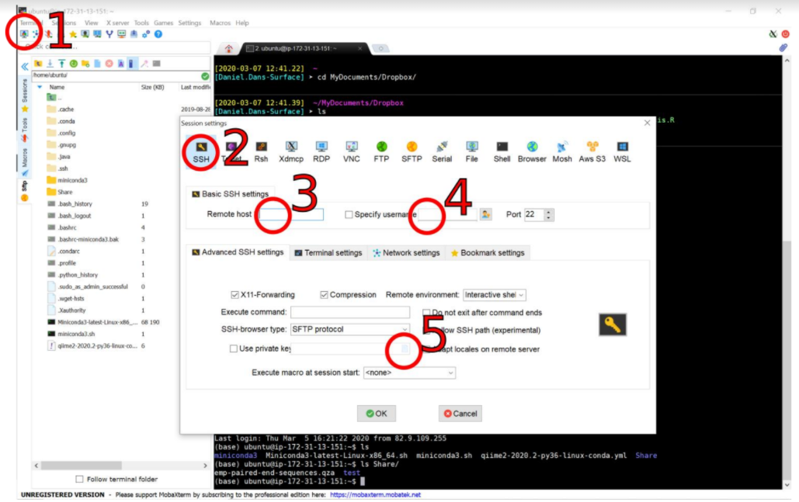

Typically when working in bioinformatics we would log into a computing cluster such as the one we have prepared for this course. Those clusters provide computational resources much more powerful than the average personal computer, allowing us to run highly complex computational tasks required by some bioinformatics analyses. When you are back at your home institutions, you can also likely use a similar method to log into the computing nodes there. How do we log in for this course? 

### Mac OS X and Linux users

#### Logging on

If you are using a Mac or Linux machine, you will need to open a `terminal` window and then type `ssh`.

`ssh` stands for [secure shell](https://en.wikipedia.org/wiki/Secure_Shell) and is a way of interacting with remote servers. You will need to log in to the cluster using both `ssh` and a keyfile that has been generated for you.

Firstly, download the keyfile and open a terminal window. Then copy it into your home directory (represented by the `~` shortcut) like so:

```shell
cp <user.pem> ~/
```  

PS: remember to replace `<user.pem>` with your user key. If you are `user2`, that should be `c2.pem`.

Give your user permission to read and write to the keyfile:  

```shell
chmod 600 <user.pem> 
``` 

Then you should be able to log in with `ssh` whatever your working directory is. You need to provide `ssh` with the path to your key, which you can do with the `-i` flag. This basically points to your identity file or keyfile. For example:

```shell
ssh -i ~/<user.pem> <user>@<ip.address> 
```

Of course you will need to update the log in credentials shown. For `user2`:  
* replace `<user.pem>` by `c2.pem`  
* replace `<user>` by `user2`  
* replace `<ip.address>` by the daily IP address, shared with you in the Slack channel (e.g. `54.245.175.86`)  

You might be prompted to accept an RSA key - if so just type yes and you will log in to the cluster!

#### Downloading and uploading files

Occasionally, we will need to shift files between the cluster and our local machines. To do this, we can use a command utility called `scp` or [secure copy](https://en.wikipedia.org/wiki/Secure_copy). It works in a similar way to `ssh`. Let's try making a dummy file in our local home directory and then uploading it to our home directory on the cluster.

```shell
# make a file
touch test_file
# upload to cluster
scp -i ~/<user.pem> test_file <user>@<ip.address>:~/
```
Just to break this down a little we are simply copying a file (`test_file`) to the cluster. After the `:` symbol, we are specifying where on the cluster we are placing the file, here we use `~/` to specify the home directory.

Copying files back on to our local machine is just as straightforward. If we want to copy the file we just uploaded to the server back to our local machine, we need to run the same `scp` command but now switching the order of the server and local directories:

```shell
# download `test_file` from server to local current working directory (.)
scp -i ~/<user.pem> <user>@<ip.address>:~/test_file ./
```

#### Making life a bit easier

If you are logging in and copying from a cluster regularly, it is sometimes good to use an `ssh` alias. Because the cluster IP address changes every day, we will not be using these during the course. However, if you would like some information on how to set them up, see [here](https://markravinet.github.io/CEES_tips_&_tricks.html)

### Windows users

#### Logging on

If you are using a Windows machine, you will need to log on using [MobaXterm](http://mobaxterm.mobatek.net) since there is no native `ssh` client. After installing it, open MobaXterm and:

1. Start a new SSH terminal (1&2).
2. Add the host address (3) - which is the daily IP address - and your username (4) - e.g. `user2`
3. On advanced SSH settings, select "Use private key" and add the downloaded pem file (5)
4. After adding the previous information, press "OK" to connect to the server.



#### Downloading and uploading files with Filezilla

Filezilla is a handy piece of software to move files from a remote server such as the Amazon cloud or a cluster at your university.

Open Filezilla and choose Edit -> Settings.


Next, choose SFTP and Add the .pem key file as indicated below and click OK.


Finally, enter the IP address and the user name and when you hit enter, it should connect you. Next time, you can use the Quickconnect dropdown menu, provided the IP address has not changed in the meantime.


Now you will see the file directory system (folders) on your local computer on the left and your folders on the Amazon cloud on the right. You can now just drag and drop files from one side to the other.  

#### Acknowledgements  
Although we have made some small adjustments, this *log in* tutorial was mainly prepared by Dr. Mark Ravinet and Dr. Joana I. Meier for their Physalia course on Speciation Genomics (https://www.physalia-courses.org/courses-workshops/course37/). We would like to thank both of them for allowing us to use it in this course. 
