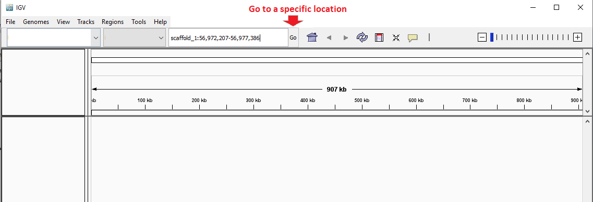

---
title: "Hands On"
layout: archive
permalink: /miss-assembly/
---  


Ok, so you have learned a lot of things about Hi-C scaffolding and (a bit on) genome curation. I want to show you a very likely example of a miss-assembly that we can identify in the Hi-C HeatMap.

The name of the guy you are going to be working with is *Eristalis pertinax* (who am I? Check me online and get a picture of me). In the folder `/home/ubuntu/Share/idEriPert2/` you are going to find:

- salsa_scaffolds.hic - this is the Hi-C HeatMap you are going to load on JuiceBox
- scaffold_1.fa       - this is the fasta sequence for scaffold_1 that you are going to look at in IGV
- scaffold_1.fa.fai   - This is the index of scaffold_1
- scaffold_1.bam      - This is the bam file of scaffold_1, it contains information of PacBio reads mapped back to it
- scaffold_1.bai     - This is the bam index for the file above

I want you to download all those files to your local machine.

Notice that you don't have the multifasta file that represents the complete genome that you will be looking in JuiceBox, but I can give you the statistics for it:

```console 
scaff/out.break.salsa/scaffolds_FINAL.fasta
A = 138801847 (28.8%), C = 102274073 (21.2%), G = 102205971 (21.2%), T = 138718687 (28.8%), N = 95500 (0.0%), CpG = 40188878 (8.3%)
SCAFFOLD        sum = 482096078, n = 381, ave = 1265344.03674541, largest = 107625594, smallest = 9583
SCAFFOLD        N50 = 27154744, L50 = 5
SCAFFOLD        N60 = 10826200, L60 = 9
SCAFFOLD        N70 = 4796154, L70 = 16
SCAFFOLD        N80 = 2626642, L80 = 30
SCAFFOLD        N90 = 1036242, L90 = 56
SCAFFOLD        N100 = 9583, L100 = 381
CONTIG  sum = 482000578, n = 572, ave = 842658.353146853, largest = 21349867, smallest = 9583
CONTIG  N50 = 3749504, L50 = 29
CONTIG  N60 = 2545817, L60 = 46
CONTIG  N70 = 1729515, L70 = 68
CONTIG  N80 = 958119, L80 = 108
CONTIG  N90 = 437266, L90 = 182
CONTIG  N100 = 9583, L100 = 572
GAP     sum = 95500, n = 191, ave = 500, largest = 500, smallest = 500
```

Now, I want you to open the Hi-C heat map (`salsa_scaffolds.hic`) for the complete genome on Juicebox and have a look at it.

The whole plot is not amazing. But do you think you see a miss-assembly on scaffold 1?

Well, I have taken the PacBio reads, mapped them back to the complete genome and extracted only the scaffold_1 for you, so you can have a look at it on IGV.

Make sure you have all scaffold_1 files (\*.fa, \*fa.fai, \*.bam, \*.bai) in the same folder. Then open IGV and load the \*.fa in `Genomes > Load Genome from File`, and load the \*.bam in `File > Load from File`.

Have a look at the mapping. Zoom in to see reads mapped. Play around IGV a little. 

Then, using the `Go` search bar (like in the image below), go to the position: `scaffold_1:56,972,207-56,977,386`  



Do you see a gap in the Pacbio coverage?

Aha! If you have a weird looking Hi-C HeatMap and NO reads crossing that region, I bet you that this is a miss-assembly!! Don't you think? :wink:

#### (optional) Saving regions of interest
IGV allows us to highlight regions of interest through the `Region Navigator` tool. To save the region that has no coverage, you first need to make sure that IGV is displaying that region (you can type the position `scaffold_1:56,972,207-56,977,386` in the search bar again). Then, on the top panel of IGV click on `Regions > Region Navigator...`. All you need to do now is to click on the `Add` button and your region will be added to the Region Navigator list. You can even give a description to your region (e.g. `drop in coverage`).

After saving your region(s) of interest, you can zoom out and browse through the whole sequence in IGV and your region will always be highlighted (in red). 
